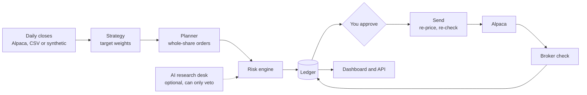
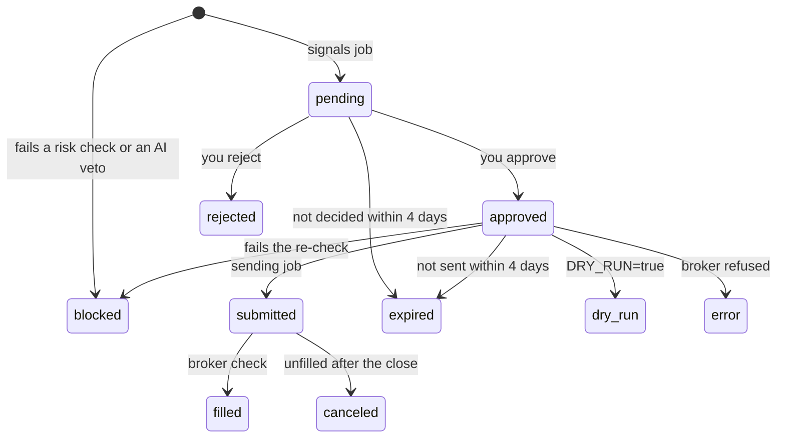

# Architecture

The app is a pipeline with one rule: **AI proposes, code decides.** Anything can suggest a trade. Only the planner, the risk engine and your approval decide what reaches the broker.

## The pieces

All backend code is in `backend/src/trader/`.

| Piece | Where | What it does |
|---|---|---|
| Strategies | `strategies/` | Pure functions from past closes to target weights, one row per day. No I/O. `TrendFollowing` holds every symbol above its 200-day average at equal weight. `Momentum` holds the top 3 by 12-month return, skipping the latest month, and rebalances on the first trading day of each month. |
| Planner | `planner.py` | `plan_intents` turns target weights, prices and the account into orders. The live pipeline and the backtester both call it. |
| Risk engine | `risk/` | `check_order` is a pure function from an order, the account and the context to a list of violations. It runs when a proposal is created and again right before sending. |
| Ledger | `db.py`, `ledger.py` | SQLAlchemy 2 tables for signals, proposals, orders, equity, AI decisions, broker checks, app state and an audit log. SQLite by default, Postgres through `DATABASE_URL`. |
| Jobs | `services/` | `pipeline.run_nightly` (signals and proposals), `execution.submit_approved` (sending), `reconcile.reconcile` (broker check), plus the kill switch, approvals, replay and the gates. |
| Brokers | `broker/` | `AlpacaBroker` wraps `alpaca-py`. `FakeBroker` is an in-memory broker for the demo and the tests. Both satisfy the same `Broker` protocol. |
| Prices | `data/` | Alpaca daily bars (split- and dividend-adjusted), a CSV file, or deterministic synthetic prices. |
| Backtester | `backtest/` | Daily, event-driven backtests through the same planner, plus metrics, reports and Gate 1. |
| AI research desk | `ai/` | The `AIResearcher` protocol, a null researcher, and an optional TradingAgents adapter. |
| Notifications | `notify/` | Telegram messages with Approve and Reject buttons, and a poller for the button presses. |
| Scheduler | `scheduler.py` | APScheduler inside the API process, on weekdays in New York time: signals at 5:15 pm, sending at 9:50 am, the broker check at 4:30 pm. |
| API | `api/` | FastAPI routes for the dashboard, with an optional bearer token. It also serves the built dashboard. |
| Command line | `cli.py` | The `trader` command. |

The dashboard in `frontend/` is React and Vite, with no state library. It polls the API every 30 seconds and whenever the tab becomes visible again.

## Planning rules

- Orders are whole entries or whole exits. There are no trims or top-ups, so the live account and the backtest can't drift apart through small rebalances.
- Exits are planned first, and their proceeds count as cash for that day's entries.
- An entry's size is its target weight or the largest entry the limits allow, whichever is smaller, times equity. The largest entry is the smaller of 10% of equity and the risk per trade divided by the stop distance (1% / 8% = 12.5%). Cash and the open-position cap also limit it.
- Buy limits sit 0.2% above the last price, rounded up to the cent. The stop sits 8% below the limit.
- Positions outside the strategy's universe are never touched. The broker check flags them instead.

## Order lifecycle

**Entries** go out as one-triggers-other orders: a GTC limit buy with a stop-loss leg. The stop exists at Alpaca the moment the buy fills, so it protects the position even if this app is off. Both legs are GTC so the stop survives past the first day. The broker check after the close cancels any entry that hasn't filled, so an entry never lingers.

**Exits** first cancel the symbol's open stop (Alpaca rejects a sell for shares already held by another order), then go out as a day limit sell.

**Sending** re-prices each approved order at the latest trade, skips entries whose price has risen more than 2% above the close they were sized on, re-sizes to the current account, and runs the risk checks again. It only sends inside the trading window: from 15 minutes after the open to 15 minutes before the close.

**The kill switch** is a flag in the ledger. Engaging it cancels every open order except protective stops, and the risk engine then rejects every new order. The broker check engages it on its own when equity falls 10% below its peak. Releasing it is always a deliberate step.

**Client order IDs** are built from the account, date, symbol and side, for example `tpA-20261113-SPY-buy`. Alpaca rejects a second order with the same ID, and the broker check flags any order with this app's prefix that the ledger doesn't know.

## Parity: the backtest trades like the app

The backtester steps through daily closes. Each day it marks positions to the close, fires stops whose level the close has reached (with no re-entry that day), asks `plan_intents` for the day's orders, and fills them at the close plus `cost_bps`.

- With `lag=1` a signal trades at the close it was computed on, which is slightly optimistic.
- With `lag=2` it trades a day later, which is pessimistic.

Live orders fill the next morning, in between the two, so Gate 1 requires a strategy to survive both. The backtester doesn't apply the daily-loss pause or the drawdown kill switch. Its report counts how often they would have fired.

`tests/test_parity.py` checks this in two ways. The live pipeline's signals must equal the backtest's weights on the same data. And replaying the real jobs day by day against the fake broker must produce the same trades as a `lag=2` backtest.

## Choices worth knowing

- **Our own backtester instead of vectorbt.** The game plan named vectorbt. A backtester built on the live planner gives exact parity with what the app will trade. A daily simulation of ten ETFs is cheap anyway. vectorbt's open-source licence also adds the Commons Clause, which restricts selling software built on it.
- **No take-profit leg.** These strategies exit when the signal says so. A fixed take-profit would cut winners short, so entries carry only a stop (one-triggers-other rather than a full bracket).
- **Whole shares.** Alpaca takes fractional quantities only on day orders, and entries here are GTC so their stop leg lasts. Whole shares also keep the backtest and the live account identical.
- **Prices.** Historical bars use the SIP feed. On Alpaca's free plan that works for data older than 15 minutes, and daily bars only need the close. The latest price for sending uses the free IEX feed.
- **Time.** The schedule, signal dates and the trading window are New York time. The database stores UTC.
- **One database per account.** The first time a database is opened, it records its mode (demo, paper or live) and account label. Opening it with different settings fails, so a demo or paper record can never land in a live ledger.

## Extending it

- **A new strategy.** Subclass `Strategy` in `strategies/`. Implement `lookback_days`, `target_weights` (each row may use only closes up to that row), `params` and `variants` (the parameters moved about 20% each way, for Gate 1), then register it in `STRATEGIES`. Copy the look-ahead test in `tests/test_strategies.py`.
- **A new broker.** Implement the `Broker` protocol in `broker/base.py` and add it to `get_broker`.
- **A new AI researcher.** Implement `AIResearcher.review(symbol, as_of)` so it returns an `AIDecision`, and add it to `get_researcher`. In veto mode, the ratings in `AI_VETO_RATINGS` block an entry. The researcher can never create an order.
